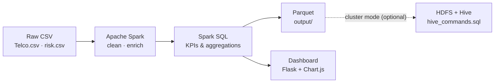

# ChurnSight — Customer Churn & Audit Risk Analytics

A batch **Big Data analytics** project built with **Apache Spark**. It answers two business questions:

1. **Why do telecom customers leave?** It analyses 7,043 subscribers to find which contracts, payment methods, services and customer groups have the highest churn.
2. **Where is audit risk concentrated?** It analyses 100 audit records (2020–2025) from four large audit firms to compare high-risk cases, fraud, industries and AI-assisted audits.

The results appear in a web dashboard that explains every chart in plain language. You don't need any data background to read it.

## Architecture



This is a pure **batch-processing** design, with no streaming components.

## Quick start (Linux / WSL)

```bash
# 1. One-time setup: installs Java if missing, creates .venv, installs requirements
bash setup_environment.sh

# 2. Run the Spark pipeline: writes Parquet + output/dashboard_data.json
bash run_all.sh

# 3. Start the dashboard, then open http://localhost:5050
bash run_dashboard.sh
```

To use a different port, run `PORT=8080 bash run_dashboard.sh`. If you skip step 2, the dashboard runs Spark itself the first time it starts. That takes about 30 seconds.

## What the dashboard shows

| Section | What you learn |
|---------|----------------|
| **Key findings** | Headline KPIs plus six one-sentence takeaways, each with a suggested action |
| **Customer churn** | Churn by contract, tenure, add-on services, payment method, internet type and age. Each chart includes the overall average for comparison |
| **Audit risk** | Yearly risk and fraud trend, riskiest industries, AI-assisted vs. manual audits, firm scorecard |
| **How it works** | The six pipeline steps, in plain language |
| **Glossary** | Every term used on the page |

Every chart has a "What this means" explanation and a **Show the numbers** table. All the text is generated from the data, so it stays correct if the data changes. The dashboard supports light and dark mode and works on mobile.

## Key results

- **26.5%** of customers left, which is about **$139K** in monthly billing.
- Month-to-month contracts churn **15×** more than two-year contracts (42.7% vs 2.8%).
- **47%** of first-year customers leave.
- Customers without online security churn **2.9×** more often.
- **Finance** has the highest share of high-risk audits (15.3%). AI-assisted audits score slightly higher on quality (7.48 vs 7.36).

## Project structure

```
├── analytics.py          # Shared Spark logic: load, clean, enrich, Spark SQL summary
├── run_pipeline.py       # Batch pipeline → output/telco, output/risk (Parquet) + dashboard_data.json
├── dashboard/
│   ├── app.py            # Flask server + JSON API
│   ├── templates/        # Page layout
│   └── static/           # Styles, chart code, bundled Chart.js (works offline)
├── Project.ipynb         # Step-by-step exploratory notebook
├── hive_commands.sql     # Hive tables & queries for cluster deployment
├── HDFS_COMMANDS.md      # HDFS upload / export commands
├── Telco.csv, risk.csv   # Source datasets
├── requirements.txt
├── setup_environment.sh  # One-time environment setup
├── run_all.sh            # Runs the pipeline
└── run_dashboard.sh      # Starts the dashboard
```

## Tech stack

| Technology | Role |
|------------|------|
| Apache Spark 3.5 (PySpark) | Data cleaning, transformation, Spark SQL analytics |
| Parquet | Columnar storage of the cleaned datasets |
| Hadoop HDFS + Apache Hive | Distributed storage and SQL warehouse (cluster mode) |
| Flask + Chart.js | Interactive dashboard |
| Java 11+, Python 3 | Runtime |

## Datasets

- **Telco.csv**: the public Telco Customer Churn dataset (7,043 customers, 21 columns).
- **risk.csv**: audit and financial-risk records for four large audit firms (100 rows, 2020–2025).
