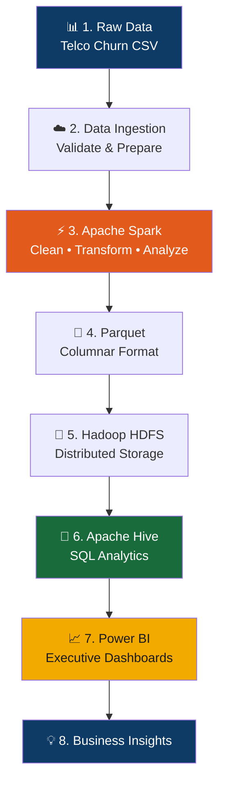

# 📊 OmniData Holding — Integrated Business Data Analytics & Executive Decision Support

> **Batch-Processing Big Data Platform** for Telecom Customer Analytics & Churn Analysis


## 🏗️ Architecture Pipeline



## 📌 Project Overview

An end-to-end **Big Data Analytics Platform** for **OmniData Holding** that integrates sector-level data into a unified analytical environment. The platform stores data using **HDFS**, processes it with **Apache Spark**, organizes it via **Parquet & Hive**, and presents executive insights through **Power BI dashboards**.

| Item | Details |
|------|---------|
| **Company** | OmniData Holding |
| **Architecture** | Batch Processing |
| **Primary Use Case** | Telecom Customer Analytics & Churn Analysis |
| **Dataset** | Telco Customer Churn Dataset |

> ⚠️ **Architecture Requirement:** This project strictly follows a **Batch Processing Architecture**. Kafka, Flume, Zookeeper, and Spark Streaming are explicitly excluded.

## 🛠️ Tech Stack

| Technology | Role in the Project |
|------------|---------------------|
| 🐧 Linux | Project execution environment |
| 🐘 Hadoop HDFS | Distributed data storage |
| ⚡ Apache Spark | Data processing & transformation |
| 📐 Parquet | Columnar storage format |
| 🐝 Apache Hive | Data warehouse & SQL analytics |
| 📊 Power BI | Interactive dashboards |
| 🐙 GitHub | Version control & collaboration |

## 📂 Repository Structure

```
├── data/          # Raw & processed datasets
├── ingestion/     # Data collection & HDFS loading scripts
├── spark/         # PySpark cleaning, transformation & analysis jobs
├── hive/          # HQL scripts: tables & analytics queries
├── powerbi/       # Dashboard file (.pbix)
└── docs/          # Proposal & architecture documentation
```

## ⚙️ Quick Start

```bash
# 0. One-time environment setup (Ubuntu)
bash setup_environment.sh && source ~/.bashrc

# 1. Run the full pipeline
bash run_all.sh

# 2. Open Power BI dashboard
#    powerbi/churn_dashboard.pbix
```

## 📈 Key Deliverables

- ✅ Fully functional batch Big Data pipeline (Hadoop, Spark, Hive)
- ✅ Cleaned dataset stored in optimized Parquet format
- ✅ Hive analytical tables with churn business metrics
- ✅ Interactive Power BI dashboard (KPIs & churn insights)
- ✅ Complete documentation & source code on GitHub

## 👥 Team Members

| # | Name |
|---|------|
| 1 | Hamada El-Khatib Gomaa Eid |
| 2 | Mohamed Atef Massad Bayoumi |
| 3 | Mennatallah Taha |
| 4 | Malak Mohamed |
| 5 | Zahraa Alaa Nassar |

---
**OmniData Holding © 2026 — Big Data Project Proposal**
